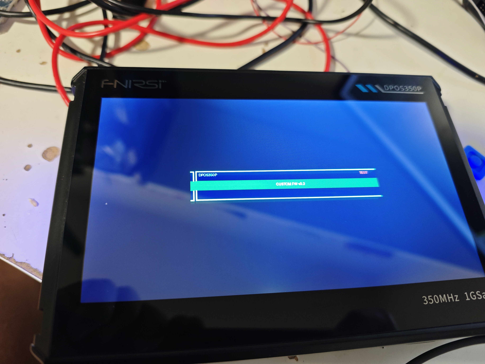

# FNIRSI DPOS350P — Firmware Reverse Engineering

Reverse engineering notes, tools and documentation for the **FNIRSI DPOS350P** 350 MHz / 1 GSa/s oscilloscope.

## ⚠ Disclaimer

This is experimental reverse engineering work. Modifying firmware carries the risk of **permanently damaging your device**. Everything here worked on one specific unit — it may not work on yours. Hardware revisions, firmware versions and individual components may differ.

**Proceed at your own risk. The authors accept no responsibility for damaged, bricked or otherwise affected devices.**

Always back up your Winbond NOR flash before making any changes.

---

**Status:** Custom firmware flash confirmed working ✅



---

## Achievements

- Full hardware identification (SoC, FPGA, flash chips)
- PCB debug header pinouts mapped (SPI flash, FPGA JTAG)
- FEL mode access via SPI CS pin on debug header
- Winbond W25Q16JV (2MB NOR) dumped and analyzed
- ISO container format reverse engineered
- **Firmware update checksum algorithm cracked**
- **Custom boot logo successfully flashed and confirmed on device**

---

## Hardware Summary

| Component | Part | Notes |
|-----------|------|-------|
| SoC | Allwinner V3s (ARM Cortex-A7) | Confirmed via FEL ID=0x00168100 |
| FPGA | GOWIN GW1N-LV9MG256C5/I5 | GW1N-9, BGA256, 8640 LUT |
| SPI NOR | Winbond W25Q16JV | 2MB, SOP-8, bootloader + main app |
| SPI NAND | Winbond W25N512GV | 64MB, WSON-8, FPGA bitstream |
| SD-NAND | CSNP1GCR01-B0W | 1GB, FAT32, holds firmware ISO |
| Display | 800×480 RGB565 | |
| Touch | GT911 | |

Chip SID: `12c00001740046207905431c34490f50`

---

## Quick Start — Custom Boot Logo

1. Install requirements: `pip install pillow numpy`
2. Prepare your logo image (PNG, any size — tool will resize to 529×95)
3. Replace logo and patch checksum:

```bash
python3 tools/dpos_tool.py replace original.iso your_logo.png custom.iso
python3 tools/dpos_tool.py verify custom.iso
```

4. Switch oscilloscope to USB storage mode (Menu → USB Connect)
5. Copy `custom.iso` to root of the USB drive (any filename works — the updater scans for any `.iso` file)
6. Safely eject and reboot — updater flashes automatically

---

## Repository Structure

```
docs/
  hardware.md     — PCB, chips, debug headers, pinouts
  fel_mode.md     — FEL access, xfel commands, memory map
  iso_format.md   — ISO container format, sections, logo format
  checksum.md     — Checksum algorithm with reference implementation
tools/
  dpos_tool.py    — verify / patch / extract / replace
dumps/
  README.md       — What to back up and how (binaries not included)
images/
  custom_logo_demo.jpg
```

---

## Credits

- Checksum algorithm identified with help from **pecostm32**'s
  [FNIRSI 1013D/1014D reverse engineering](https://github.com/pecostm32/FNIRSI-1013D-1014D-Hack)
- Discussion: [EEVBlog forum thread](https://www.eevblog.com/forum/testgear/fnirsi-dpos350p-reverse-engineering-custom-firmware/)

---

## License

Documentation and tools: MIT  
Original FNIRSI firmware binaries are **not** included in this repository.
